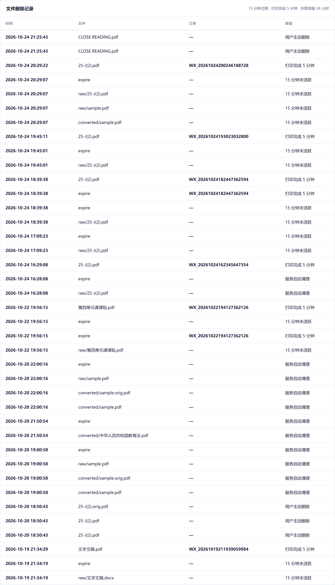

# 思印客 Silnk · 功能与创新清单

> 更新时间：2026-10-24（按当前工作区、Git 历史与本地测试复核）
> 定位：校园文档交付终端。不是「一台共享打印机」，而是把「上传 → 检查 → 计价 → 支付 → 打印 → 取件 → 删除」做成一条可审计的交付链路。
> 说明：本文只写已经实现的功能；未实现的统一标「规划」。不把规划写成已上线。

---

## 一、产品定位

普通共享打印机解决的是「把文件送到纸上」。
思印客解决的是「让这份纸不出错、不被拿错、不留下隐私」。

三条主线：

1. 打印前：格式检查、一键修复、A3 拆 A4、空白页/彩色页/贴边检查。
2. 打印中：四档价 + 覆盖率折扣 + 空白页不计费 + 智能选机 + 班级批量封皮。
3. 打印后：取件码核对、文件自动删除、删除记录可查、设备端最小化可见。

---

## 二、用户端功能（已上线）

### 首页布局（本轮改版）

- 顶部为 4 屏创新点轮播（打印前体检 / 透明计价 / A3 拆 A4 / 交付承诺），5 秒自动切换，圆点带进度，悬停、键盘聚焦或切到后台时暂停。
- 轮播下方是设备状态条：当前打印机、在线状态、打印价格快捷入口；打印机列表默认收起，需要时点「切换打印机」展开。
- 功能栏只保留两个真实入口：文档打印（PDF / Word / Excel）与照片打印（JPG / PNG 打印到 A4），点击直接选文件。
- 底部导航为 首页 / 订单 / 我的；有文件进入支付流程时自动让位给底部支付条，避免两条固定栏叠加。
- 定时出纸、拼单、班级批量、交付承诺等仍在各自功能区或支付流程里选择，不占用首页功能位。
- 新增对外宣传页 `/intro/`（`static/landing/index.html`，原生 HTML/CSS，白底 + 靛蓝 `#4C63F0`，与用户端、管理端统一）：首屏体检示意（标注「示意」）、7 步交付链路、核心能力、基础价与覆盖率折扣表（数值与 `routers/pay.py` 一致）、功能进度区（已上线 / 待做如实标注）。`/intro` 自动补尾斜杠跳转。
- 管理端残留的旧蓝 `#1F6FEB` 已统一为 `#4C63F0`（按钮阴影、输入框聚焦环、概览趋势柱图），遮罩与弹窗阴影改为中性深色。

### 0. 账号注册 / 登录（本轮新增）

- 登录与注册分成两个页面：`/login` 登录、`/register` 注册；登录页支持「密码登录 / 验证码登录」两种方式。
- 注册必须验证手机号并设置登录密码（8–64 位），密码使用 PBKDF2-SHA256 加盐哈希存储，数据库不存明文。
- 老账号（早期只有验证码、没有密码）可在注册页用验证码补设密码，验证通过后直接写入并登录。
- 验证码登录只允许已注册账号，不再自动注册；未注册会提示「请先注册」。
- 密码登录按「手机号 + IP」限流：10 分钟内失败 8 次后暂时锁定，避免在线爆破。
- 手机号 + 短信验证码，登录 token 7 天有效。
- 验证码三层限流：同手机号 60 秒一次、每小时最多 5 条；同 IP 每小时最多 10 条。
- 管理端用户列表对手机号脱敏（138****8000）。
- **必须登录才能上传与下单**；订单按账号归档（`print_jobs.user_id`），换设备也能看到自己的历史订单。
- 顶部显示昵称与「退出」，未登录/被封禁会自动退回登录页。
- 管理端「用户」页可查看注册用户并封禁/解封；封禁立即生效，已登录的旧 token 下一次请求即 403。
- 如实说明：真实短信服务与微信/支付宝授权登录尚未接入。未配置短信服务时为显式标注的**演示验证码模式**（验证码直接显示在登录页）；微信/支付宝按钮置灰标「待接入」。

### 0.5 共享资料库（本轮新增）

- 下单页提供「共享到公开资料库」勾选，默认不勾选；勾选后本单立减 5%。另有贡献折扣：该用户已公开资料被真实打印的次数达到 1 / 5 / 20 / 50 次时，分别享 3% / 5% / 8% / 10%，与本单共享 5% 取较高值，不叠加。
- 只共享「本次实际打印范围」的成品 PDF，不共享原始文件；班级批量含姓名封皮，禁止勾选共享。
- 打印量在「付费入队」时累计（下载、取用、未付款都不算），确保统计的是真实打印；资料库页与审核页都会显示已打印次数 / 页数。
- 发布流程：付款入队时复制成品 → agent 初审（DeepSeek 文本审核 + 本地身份证号/手机号/银行卡号/住址扫描）→ 商家管理员后台二次复审 → 通过后才公开。
- 未配置 DeepSeek（且未配置 GLM 回退）或调用失败时，如实标记为「未接入 / 调用失败」并转人工，不假装通过；扫描件没有文字层时也会转人工；本地检测到敏感信息会标记为风险，提示管理员谨慎公开。
- 公开页 `/library` 支持搜索、分类筛选、下载；登录用户点「拿去打印」会把 PDF 复制进本次上传会话，按正常流程选规格下单。
- 首批已导入 50 份公共领域 / 官方公开资料（40 份文学、10 份法规），来源中文维基文库，均标注来源；不包含受版权保护的教材、论文或试卷。
- 管理端「资料库」页支持直接上传 PDF / Word / Excel（Word/Excel 由 LibreOffice 自动转 PDF）；管理员上传视为已审核，发布后立即公开。
- 分类不再写死在代码里：分类存于数据库表 `library_categories`，管理端「资料库」页可新增 / 删除分类，用户端下单页的共享分类下拉与 `/library` 筛选同步跟随；仍有资料使用的分类与「其他」不允许删除。
- 优惠口径：按文件逐个四舍五入后相加，前端预估与后端结算共用同一折扣率（本单共享 5% 与历史贡献折扣取较高值）；账单记录 share_library / library_discount / library_discount_rate。

### 1. 上传与转换

- 支持 PDF / Word / Excel / JPG / PNG。
- 单文件上限 100MB，前端先拦、后端分块落盘边写边校验，不能绕过。
- Word / Excel 走 WPS 或 LibreOffice headless 转 PDF，不需要图形界面。
- 上传会话 15 分钟不活跃自动删除。

### 2. 打印前检查

转换完成后自动分析（纯本地规则，不调用大模型）：

- 空白页：没有文字、图片、矢量图形才算空白。
- 彩色页：文字颜色 + 低分辨率渲染双重判断。
- 内容贴边：最小页边距小于 4mm 时提示可能被裁切。
- 横竖版混排：提示翻面方向。
- 图片分辨率过低（本轮新增）：页内位图有效分辨率 < 150 DPI 时提示打印会发糊，并给出最低 DPI。
- 页面尺寸不统一（本轮新增）：A4/A3/A5/Letter 混排时提示「各页按原尺寸打印、装订会不齐」；整份非 A4 时提示确认纸盒放对纸。
- 双面奇数页（本轮新增）：双面打印且页数为奇数时提示「最后一张背面为空白」，避免以为漏印。
- 页缩略图：前 3 页直接预览，点击打开完整 PDF。
- 最多检查前 200 页，超出部分明确提示「仅检查了前 N 页」。
- 所有体检提示只做提醒，都不阻断下单。
- 检查结果统一收进「打印前检查报告」卡片：顶部显示待确认类别与数量（格式 / 隐私 / 空白页 / A3），下方分区展示，可直接一键修复、一键打码、A3 拆分或跳过空白页，不需要在多个卡片之间来回找。

### 3. 空白页不计费 + 本单已省多少钱（本轮新增）

- 打印前自动识别空白页，默认**不打印、不计费**。
- 用户可以在文件卡片上取消勾选「跳过空白页」，取消后按原样打印并收费。
- 结算栏显示：
  - 预估费用
  - 本单已省（绿色）
  - 明细：空白页省了多少、彩色覆盖率折扣省了多少
- 后端结算与前端预估使用同一份空白页数据、同一套覆盖率规则，保证「显示价 = 结算价」。
- 打印文件在服务端重新生成：只保留实际要打印的页，取件码不印在纸上，原文件不修改。
- 订单详情会保留「本单已省」金额，方便事后核对。

### 4. 格式合规检查（按学校模板）

内置模板（下单时文件卡片上可切换）：

| 模板 | 页边距（上下/左右） | 行距 | 页码 | 封面 | 参考文献 |
| --- | --- | --- | --- | --- | --- |
| 通用论文 | 25 / 30·20 | 1.5 | 必需 | 必需 | ≥3 条 |
| 通用作业 | 20 / 20 | 1.5 | 不要求 | 不要求 | 不要求 |
| 自由格式 | 不判定 | 不判定 | 不要求 | 不要求 | 不要求 |
| 学位论文（国标） | 25 / 30·20 | 1.5 | 必需 | 必需 | ≥10 条 |
| 实验报告 | 25 / 25·20 | 1.5 | 不要求 | 不要求 | 不要求 |
| 简历 | 12 / 12 | 不判定 | 不要求 | 不要求 | 不要求 |
| 公文（GB/T 9704） | 37·35 / 28·26 | 1.75 | 必需 | 不要求 | 不要求 |

- **自由格式**：完全跳过格式判定，分数固定 100、问题列表为空，界面显示「自由格式 · 不做格式检查」。
  用于海报、表格、手抄笔记这类本来就没有统一版式的文档——用户只是想把文件打出来，不该被模板标准挑刺。
  该模板下「一键修复」只做内容级操作（删空白页 / 插封面 / 双面配对），**不动页边距、不加页码**。
- 模板由 `templates/*.json` 扩展，新增学校模板不需要改代码；同时支持「不判定」的行距（`line_spacing: null`）与字体白名单为空。
- 上述模板边距/行距为校园常见要求，非某校官方文件，界面上如实写明「模板」而非「标准」。

检查项与置信度：

| 检查项 | 判定方式 | 置信度 |
| --- | --- | --- |
| 页边距 | 内容块外接矩形 | 高 |
| 页码 | 页眉页脚区域正则匹配 | 高 |
| 封面 | 首页字号与文本密度 | 中 |
| 参考文献 | 标题与条目正则 | 中 |
| 字体 | 按字符数统计显著字体 | 提示 |
| 行距 | 基线间距 ÷ 字号取中位数 | 提示 |

- 扫描件（图片页占比 > 50%）自动降级：不误报封面、参考文献、页边距，只提示「扫描件检查降级」。
- 每个问题都带 `confidence` 字段，低置信问题标「需复核」，不假装确定。

### 5. 一键修复

- 删除空白页。
- 按模板缩放页边距。
- 补页码（`n / 总数`）。
- 首页没有大字标题时插入封面。
- 双面打印时补齐奇偶页，避免下一份从背面开始。
- 原文件备份为 `.orig.pdf`，修复结果覆盖当前 PDF，页数同步回文件列表。
- 修复完成后自动重新检查、重新计价。

### 6. A3 拆 A4（本轮新增）

- 上传的 PDF 里如果有 A3 页面，文件卡片上会出现「A3 拆 A4」按钮，并提示检测到几页 A3。
- 横向 A3 左右切开，得到两张 A4 纵向；纵向 A3 上下切开，得到两张 A4 横向。
- 只处理 A3 页面，A4 及其他尺寸页面原样保留；混排文档不会被打乱。
- 矢量切分，不转图片，文字仍然可搜索、可复制。
- 旋转过的页面先把旋转烘进内容再切，避免切错边、丢内容。
- 原文件备份为 `.orig.pdf`，拆分后页数、打印范围、计价自动同步。

### 7. 扫描件 OCR

- 本地 Tesseract，不依赖云服务；优先 `chi_sim+eng`，200dpi，`--psm 6`。
- 只报三类低置信问题：页码、参考文献标题/条目数、空白/图片页。
- 字体、行距、页边距在扫描件上不判定。
- 结果按文件 mtime 缓存，避免重复识别。
- 服务器已安装 Tesseract + 中文语言包；本机 Windows 未安装时按钮不显示，并提示上传文字版。

### 8. 隐私检查与一键打码

- 上传转换完成后自动扫描文本层，识别 18 位身份证号、11 位手机号（兼容 `138 0013 8000`、`138-0013-8000` 写法）、16–19 位银行卡号（Luhn 校验或分组格式）与中文住址，文件卡片上显示「隐私检查」结果。
- 只做本地规则匹配，不调用外部服务，文件不出服务器；检出内容只展示掩码（如 `110***********1234`）。
- 「一键打码」把上述四类信息全部覆盖成黑块并覆盖原 PDF，原件备份为 `.orig.pdf`；打码后再次扫描结果为 0。
- 扫描件没有文字层，识别不到，会明确提示「无法自动识别，请人工翻看」，不假装检查通过。
- 当前覆盖身份证号、手机号、银行卡号、住址四类；涉黄、涉政、侵权的图像识别不在本期范围。

### 9. 计价规则

四档基础价（元）：

- 单面黑白 0.3 / 页
- 单面彩色 0.8 / 页
- 双面黑白 0.5 / 张
- 双面彩色 1.5 / 张
- 双面奇数页时，最后一页按单面价。

彩色覆盖率分档折扣：

- 覆盖率 < 0.5%：按黑白价。
- 0.5% ~ 5%：彩色价 × 0.5。
- 5% ~ 30%：彩色价 × 0.8。
- > 30%：全价。

叠加规则：

- 空白页先剔除，再按剩余页计算。
- 覆盖率折扣与空白页免费可以同时生效。
- 结算栏展示原价、实付、省下金额及明细。

### 10. 班级 / 社团批量

- 一次上传、一个人付全款、统一取件。
- 填写份数与名单（名单可选）。
- 打印 2 份及以上时，每份前面自动插入一张姓名封皮：
  - 第 i / N 份
  - 姓名（未填则写「未填姓名」）
  - 文件名、正文页数、单双面
  - 订单尾号、组织者
- 封皮不印取件码（取件码只在用户端订单详情展示）；出纸即一份一叠，按封皮姓名分装。
- 双面时自动补空白背面，保证每份正文从正面开始。
- 名单人数少于份数：剩余封皮写「未填姓名」。
- 名单人数多于份数：只给前 N 个人印封皮，界面会提示。
- 重名自动去重；单次最多 100 份、总页数最多 2000 页。

### 11. 智能选机

根据以下因素给每台打印机打分并说明原因：

- 预计等待时间（队列深度 ÷ 打印速度）
- 距离（有经纬度时按直线距离折算）
- 是否支持彩色 / 双面
- 纸张余量是否足够
- 用户请求的能力与机器能力不匹配时扣分

管理端可以配置门店名、地址、经纬度、打印速度、是否支持彩色/双面。

### 12. 拼单打印（主打创新，本轮新增）

面向大学生**个人**（不是班级包月）：一个人发起，把链接/二维码发到宿舍群、课程群，
同学各自扫码上传自己的文件并填姓名，系统自动合并成一单。

- 发起：填发起人姓名 → 生成 6 位短码（去掉 0/O/1/I 等易混字符）与分享链接 `/?group=短码`。
- 分享：前端本地用 `qrcode` 生成二维码，不依赖外网二维码服务，现场没网也能扫；链接可一键复制发群。
- 加入：同学扫码打开加入页，上传自己的文件、填姓名（会印在封皮上），加入即计价。
- 人越多越便宜：3 人 9 折、5 人 8 折、10 人 7 折，按全单合计打折；
  加入页与发起页每 5 秒刷新，实时显示「当前折扣」「还差几人再降一档」。
- 两种付款方式，发起时选择：
  - **AA 各付各的（默认）**：发起人先「锁定人数」，系统按当前人数算好折扣，给每个成员生成独立账单、独立取件码；成员从自己的拼单页支付自己的份额，付完即可各自取件。锁定后不能再加人；没人付款前发起人可取消锁定重新拉人，已有人付款则不能取消。
  - **发起人统一付**：发起人一次付清、统一取件；每人一份自己的文件，前面加一张姓名封皮，取件时按姓名分拣。
- 付款与打印解耦：AA 每个成员付自己的账单后，自己的文件立即入队打印；不会因为某个人没付而卡住其他人。
- 防重复结算：AA 每人的账单号唯一，提交付款后账单即失效；统一付重复打开只返回同一收款码，不会重复生成账单。
- 文件生命周期：加入时把文件复制到 `uploads/group_{短码}/converted/`，
  不依赖成员自己的会话目录（避开 15 分钟不活跃清理与重启清空）；已结算 24 小时后清理。
- 计价复用后端唯一实现 `pricing.price_file`，与用户端预估、普通下单完全同一套规则；AA 按成员金额比例分摊，四舍五入差额补到第一位，保证合计与总价一致。
- 如实说明：拼单短码当前没有过期时间；账单保存在数据库，服务重启不丢未付款账单。

### 13. 支付

- 当前主通道：个人微信收款码（无商户号）。
- 用户扫码付款后点「我已支付」，订单立即入队，流水记为「待核验」。
- 管理端在账单流水页人工核对到账后点「确认收款」。
- 不假装有到账回调；页面上明确写「待核验」。
- 支付宝通道代码保留，密钥未配置时不会启用。

### 14. 取件码

- 下单时生成 6 位数字取件码。
- 付款弹窗、支付成功提示、订单详情、管理端订单列表与 CSV 都能看到。
- **不打印在纸上**：单份订单只复制所选页范围，不再每页盖章；班级批量/拼单的姓名封皮也不印取件码，避免多耗墨粉、也便于纸张复用。
- 如实说明：没有储物柜/门锁，取件码只能防拿错，不能阻止别人提前拿走已出的纸。它是取件凭证，不是一次性核销。
- 因为纸上没有码，同一台机器连续出纸时需要靠订单时间、姓名封皮与用户端订单详情对照认领；「线上取件核验页」为规划。

### 15. 交付承诺（主打创新，本轮新增）

共享打印机只敢承诺「出纸」，这里承诺「结果」。下单时就把完成时间写死在订单上：

- **预计完成时间（下单即显示）**：按「前面排队的页数 + 本次页数 ÷ 该机打印速度」估算，加固定预热/取件缓冲，得到承诺完成时间 `eta_deadline`，在付款弹窗、订单详情里直接显示「承诺 N 分钟内完成 · 预计 HH:MM:SS 打完」。
- **超时免单**：打印机上报 `completed` 的时刻晚于 `eta_deadline`，自动置为超时免单，并把对应收款流水同步改状态——
  - 用户声明已付、待核验（submitted）→ **免收（waived）**，管理端不再确认收款；
  - 管理端已核验收到款（confirmed）→ **待退款（refund_pending）**，线下人工退还。
  - 如实说明：个人收款码没有自动退款通道，这里不假装自动退款，只在账单流水页如实标「已免收 / 待退款」。
- **格式不对免费重印**：用户对已完成的订单提交重印申请并写明原因，管理端审核通过后免费重印（金额 0，记录 `reprint_of` 指向原单）。
  - 付款入队时会另存一份重印副本（`reprint_cache/`），订单完成 5 分钟后与源文件一起清理；窗口内审批可直接复用副本重印。
  - 副本已清理时，系统如实提示「源文件已按承诺删除，请重新上传，重印仍免费」，不假装拿旧文件重打。
- **完成 5 分钟自动删文件**：打印完成后 5 分钟删除用户源文件与中间产物，兼顾隐私；重印申请与删除互不冲突——删了就让用户重新上传，仍免费。

### 16. 订单跟踪

状态机：

- `scheduled`：已预约，未到点（定时打印，未进打印队列）
- `pending`：已支付，待打印
- `printing`：打印中
- `completed`：打印完成，待取件
- `failed`：打印失败
- `canceled`：预约已取消（用户未到点前主动取消）
- `expired`：预约过期（到点后 12 小时仍未打印，自动作废）

- 状态由打印机端真实上报，不是按时间猜。
- 打印进度：客户端按份逐份提交，每完成一份上报 `progress_copies / progress_pages`，
  用户端订单详情与管理端订单列表显示「已提交 X/Y 份 · N 页」。
- 打印失败自动重试 2 次（间隔 3 秒），仍失败才标记 `failed`；并触发 R6 打印失败告警（企微推送）。
- 出纸异常：心跳在线、订单卡在 `printing` 超过 5 分钟、且没有任何出纸检测事件时触发 R6；X5 上报出纸事件后条件解除，告警自动关窗。
- 卡在 `printing` 超过 30 分钟自动标记失败。
- 用户端「最近订单」每 8 秒刷新，可查看金额、取件码、省下金额、批量信息、打印进度。

### 17. 隐私与文件生命周期

- 未付款上传会话：15 分钟不活跃自动删除。
- 用户点删除：立即删除原文件、转换文件、修复备份、OCR 缓存，并留记录。
- 打印完成：5 分钟后删除 `uploads` 下的源文件与中间产物。
- 失败/完成残留的待打印副本：24 小时后清理。
- 每次删除写入 `file_deletions` 表，管理端「接入状态」页可查。
- 打印机端最小化：
  - 下发的文件名是订单号，不是真实文件名。
  - 只下发打印必需字段（页范围、份数、单双面、纸张、色彩、设备）。
  - 不下发金额、批量名单、取件码。
  - 客户端日志只记订单号文件名。
- 待打印文件下载接口增加路径穿越防护。

### 18. 定时打印 · 预约出纸（本轮新增）

- 下单时在结算栏勾选「定时出纸」并选择时间（`datetime-local` 选择器，最早为当前时间 +1 分钟）。
- 限制：最少提前 1 分钟（太近等于即打，没有意义），最多预约 7 天内；超出范围后端直接拒绝并回明确提示。
- 实现方式：**付款即备好待打印文件并落库，但不进打印队列**（订单状态 `scheduled`）；
  后台每 30 秒扫描一次到点的预约单，改成 `pending` 并放行给打印机端，复用现有队列与轮询，不新增任何硬件依赖。
- 交付承诺从预约时间起算：承诺完成时间 = 预约时间 + 预计耗时，而不是从下单时刻起算。
- 到点后 12 小时仍无人打印（设备离线 / 现场失联）自动作废为 `expired`，避免隔天突然出纸；
  即打订单（无预约时间）完全不受该规则影响。作废时**同步把该单从内存打印队列剔除**，
  否则已放行、仍滞留在队列里的预约单会在设备恢复后照旧出纸，与「作废即不再打印」矛盾。
- 用户可在订单详情里「取消预约」（仅未到点的 `scheduled` 单可取消）；归属校验双重保障：
  登录用户按用户 ID 校验，**匿名会话按下单时的会话目录校验**，避免任意匿名会话拿到订单号越权取消他人预约单；
  已付款的收款状态如实记为「待退款」——个人收款码没有自动退款通道，需现场人工退回，不假装自动退款。
- 可预约上限 7 天与待打印文件 24 小时清理规则不冲突：`clean_stale_pending` 只清理 `failed/completed` 残留副本。
- 如实说明：当前是「到点自动出纸」，不是「排队优先级预约」；同一时间多单预约时按预约时间先后放行。

### 19. 点位信息与到店体验（本轮新增）

- 用户端选机卡片展示点位信息：门店名称、地址、营业时间、当前排队页数与预计等待分钟。
- 有经纬度时提供「导航」入口，跳转高德地图标记页；没有经纬度时不显示，不编造位置。
- 排队页数按该设备未完成订单的页数 × 份数统计，未指定设备的订单计入共享队列；预计等待 = 排队页数 ÷ 该机 speed_ppm。
- 管理端设备详情新增「营业时间」字段，与门店名称、地址、经纬度一起维护；这些字段都参与用户端展示。
- 用户端顶部选中设备时同时显示「设备名 · 门店名」，不用展开列表也能确认点位。

### 20. 多页合一排版（本轮新增）

- 文件卡片新增「排版」选择：1 页/张（原样）、2 页/张（上下）、4 页/张、6 页/张，用于讲义、资料合集等场景。
- 后端用 PyMuPDF 矢量拼版，输出固定 A4 纵向：2 页 = 1×2，4 页 = 2×2，6 页 = 2×3；按比例缩放居中，不转图片，文字仍可搜索。
- 第一次排版时保留原始 PDF 备份（`.layout-src.pdf`），切换档位始终从原始文件重排，不会越缩越小；选「1 页/张」可恢复原样。
- 排版后同步更新文件总页数与打印范围，按排版后的张数计价，前端预估与后端结算保持一致。
- 已知边界：暂不支持骑马钉小册子、6 寸照片无边距排版、横向讲义版式；这些仍为待做。

---

## 三、管理端功能（已上线）

- 概览：实时设备表、待处理告警、今日打印页数趋势图。
- 设备：设备列表、在线状态、纸量、队列深度、设置纸盒容量/剩余张数、重启客户端、打印测试页、实时日志。
- 设备详情：能力与位置配置（彩色/双面/速度/门店名称/地址/营业时间/经纬度）。
- 订单（商家）：筛选、分页、导出 CSV、金额、色彩、取件码、真实文件名；运维只能看到订单状态，看不到金额。
- 统计报表（商家，本轮新增，`/admin/reports.html`）：按日期范围、租户、设备筛选，展示订单数、完成率、打印页数、用纸张数、实收营收、平均客单价；含每日趋势柱状图、按天/按设备/按租户三张明细表；支持导出「日报 CSV」和「订单明细 CSV」，CSV 带 BOM，Excel 双击不乱码。口径与计价一致：页数 = 单份页数 × 份数，纸张 = 单面按页数 / 双面按 ceil(页/2) × 份数，营收只算已支付且未免单订单。
- 账单（商家）：收款流水、已核验/待核验金额、今日收款、确认收款、收款码配置。
- 告警：R1~R6 规则（R6 含打印失败与出纸异常）、处理、企微测试推送。
- 运维 agent：处置留痕（证据 → 诊断 → 动作）、手动跑一轮；物理故障只上报人工，在线设备打印链路假死自动重启自愈。
- 价格对比（商家可改）：全局四档价、每台机器独立定价。
- 资料库审核（商家）：agent 初审后的二次复审，支持预览待审 PDF、通过并公开、驳回并记录原因；展示每份资料的已打印次数 / 页数；运维角色不可见。管理端整体改为与用户端一致的浅色蓝风格。
- 用户（商家）：注册用户列表、封禁/解封；封禁后该账号立即无法登录与下单。
- 接入状态：如实区分「已接入 / 待配置 / 待做」，并展示文件删除记录。
- 租户与结算（平台方，`/admin/tenants.html`）：开通租户、查看列表、停用/启用、改套餐/上限/到期/抽成、查看各租户营收与未结金额、发起结算；租户用户入口链接可直接复制。

### 管理端角色分离

- 商家密钥（环境变量 `SECRET_KEY`）：全部权限。
- 运维密钥（环境变量 `OPS_KEY`）：只能看设备、告警、订单状态，打印测试页、重启客户端、设置纸量/位置/能力、看删除记录。
- 运维不能改价格、看账单流水、确认收款、删除设备、新增设备；这些操作后端直接返回 403，不只是页面隐藏。
- 运维登录后侧栏自动隐藏订单/账单/价格；直接打开这些页面会被退回概览。
- 顶栏显示当前角色徽标（商家 / 运维）。
- 未配置 `OPS_KEY` 时，运维登录关闭，只有商家密钥可用。

### 运维 agent（按故障类型分档处置，本轮新增）

后台每 20 秒跑一轮，只做两类事，边界写死在代码里：

| 类型 | 判据 | 处置 | 为什么 |
| --- | --- | --- | --- |
| 物理故障 | 告警 R1 缺纸 / R2 离线 / R3 断电 / R4 门磁卡纸 / R5 取件顺序不符 | 只上报：翻译成现场处置动作并落库留痕（`action_status=reported`），企微推送仍由告警引擎负责，agent 不重复推送 | 自动重启解决不了纸盒空了，还可能把卡住的纸撕坏，必须人工到现场 |
| 打印链路假死 | 设备**心跳正常**（在线）但订单卡在 `printing` 超 5 分钟 | 自动下发 `restart` 指令自愈，同时把该单如实标 `failed` 并推企微 | 心跳正常说明客户端主进程还活着，卡住的是 CUPS / ipptool 打印链路，重启是安全的 |

- 重启**不会续打**已出队的任务，因此同时把该单标 `failed`（可走免费重印），不让用户干等 30 分钟兜底超时。
- **设备离线不自动重启**：客户端进程已不在，命令下发不到（10 分钟 TTL 过期后连执行痕迹都没有，只会制造「已下发」的假象）——归入物理故障，人工现场。
- 同一设备 30 分钟内最多自愈一次（`RESTART_COOLDOWN_SECONDS`），防止把 agent 自己卷进重启循环；冷却中只记 `restart_cooldown / skipped`。
- 所有处置落 `agent_runs` 表留痕（kind / device_id / alert_id / job / verdict / reason / action / action_status / command_id），管理端可查完整链路。
- 接口：`GET /api/agent/runs`（可带 `device_id`、`limit`）查留痕，`POST /api/agent/scan` 手动跑一轮；均需管理端密钥（商家与运维都可访问）。
- 与兜底的关系：`STALE_PRINTING_SECONDS = 300` 必须早于 `db.fail_stale_printing` 的 30 分钟兜底，否则订单先被兜底标 failed，agent 就没机会介入。

---

## 四、多租户与租户控制台（软件订阅线，已上线）

一个租户 = 一个客户（打印点 / 学校文印室）。平台方卖的不只是设备，还有可独立运营的一整套管理能力。

- 数据模型：`tenants`、`subscriptions`（含抽成比例 `fee_rate`）、`tenant_price`、`tenant_settlements`；`device`、`order`、`alert` 增加 `tenant_id`。
- 平滑迁移：启动时自动创建 `default` 租户，历史设备/订单/告警自动回填，原有单租户部署行为完全不变。
- 每租户独立密钥：租户密钥与平台商家/运维密钥严格隔离，租户密钥访问平台接口一律 401；密钥比较使用常量时间。
- 三级计价：设备独立价 > 租户默认价 > 平台全局价，结算与前端显示始终取同一处结果。
- 客户端用环境变量 `TENANT_ID` 上报设备归属，未配置即默认租户；多台打印机需设置不同设备 ID。
- 用户入口（真实可用）：每个租户有独立链接 `/?t=<tenant_id>`，用户从该链接进入只看到本租户设备，推荐也只在本租户内进行；不带参数时按默认租户处理，原有部署不受影响。
- 订阅真正生效（不再只是展示）：
  - 租户停用、订阅停用或到期后，该租户设备不再出现在用户端，下单直接拒绝，租户也不能再改价。
  - 新设备注册时校验打印机上限（`printer_limit`，0 表示不限），超限返回 403；已存在设备重新注册不受配额影响，避免客户端重启被挡。
- 营收与结算（平台统一收款，手动结算）：
  - 营收只统计已付款订单（写入 `out_trade_no`），未付款与超时免单（`waived`）不计；提供今日 / 本月 / 累计 / 未结算四个口径。
  - 平台按租户配置抽成比例（新租户默认 10%，默认自营租户为 0），结算时生成一条 `tenant_settlements` 记录并给订单打 `settled` 标记，同一单不会重复结算。
  - 系统只做账目结算，真实打款线下完成；支付宝自动分账仍为待做，页面如实标注。
- 租户控制台 `/tenant/`：
  - 用平台方交付的租户密钥登录，密钥只存浏览器 localStorage，页面源码不含任何默认密钥。
  - 只看本租户的订阅与点位、设备、订单、告警，可自助修改本租户默认单价（订阅不可用时禁止改价）。
  - 新增「营收与结算」：今日 / 本月 / 累计 / 未结应结、平台抽成、历史结算批次，以及可复制的用户入口链接；页面每 5 秒自动刷新。
- 平台管理端新增 `/admin/tenants.html`「租户与结算」页：开通租户（一次性显示明文密钥）、改套餐 / 上限 / 到期 / 抽成、停用启用、查看营收、发起结算。
- 待做（页面与 `/api/status` 均如实标注）：在线支付自动分账、自动续费、租户自助开通、租户自助清除本租户价、资料库跨租户隔离。
- 实现中修掉的真实问题：平台方定价的 `POST /api/tenant/{tenant_id}/price` 曾声明在 `/api/tenant/self/price` 之前，动态路由把 `self` 当租户 ID 抢匹配，导致租户自助改价 403；已调整路由顺序并加回归测试。

---

## 五、设备端与后端

- 打印机客户端支持 Windows（SumatraPDF）与 Linux（CUPS + ipptool）。
- 客户端启动与心跳时自动上报本机打印队列：
  - Windows 用 `Win32_Printer` 枚举名称、驱动、端口、默认、离线状态，并用
    `Get-PrintConfiguration` 读 `Color` 与 `DuplexingMode` 判断彩色与自动双面。
  - Linux 用 `lpstat -v` 枚举 CUPS 队列与设备 URI，用 `lpstat -l -p` 取型号描述、
    `lpoptions -p NAME -l` 读 PPD 里的 `Duplex` / `ColorModel` 判断能力。
  - 过滤 PDF、传真、OneNote 等虚拟打印机。
- 能力字段（彩色 / 双面）只在设备首次注册时写入，管理端手动改过之后客户端不再覆盖，
  避免设备每次重启把人工设置冲掉。
- 管理端「新增设备」可从发现列表一键填入名称/驱动/端口，也支持手工填写任意型号。
- **零配置接入（本轮新增，Windows 工控机）**：运行 `client/setup_gui.py` 图形向导，
  只需填服务器地址并选本机打印机队列，点「开始接入」后屏幕显示 4 位接入码；
  管理端「设备 → 待接入」看到主机名、队列、接入码，填点位名称/租户/地址/经纬度后批准，
  客户端自动领取设备令牌并写入 `client/config.json`，随后可自动启动打印客户端。
  接入后无需再手改 bat、手设 `PRINTER_DEVICE_ID` / `TENANT_ID` / `SECRET_KEY`。
- 零配置鉴权：设备令牌只存 sha256 哈希，管理端可吊销；令牌只能操作自己这台设备
  （注册、心跳、取任务、上报状态、下载自己的文件），不能看设备列表、不能改租户。
- 配对安全：接入码 30 分钟过期，轮询必须带申请时下发的一次性 secret，
  令牌明文只返回一次；管理端不批准则设备不会入网。
- 型号不做白名单限制：只要系统装了驱动或 CUPS 队列，就能接；型号只作展示。
- **佳能 G3800 接入**：Linux 安装 Canon 官方 `cnijfilter2`（G3000 series）或 Gutenprint
  驱动后建 CUPS 队列，`PRINTER_NAME` 填队列名；客户端会自动识别为
  `Canon G3800 series`、彩色 = 是、自动双面 = 否。该机型无自动双面，管理端不要勾选
  双面能力，否则用户付双面价却单面出纸。Windows 下装官方驱动后同样自动识别。
- 心跳每 25 秒上报，60 秒无心跳视为离线。
- 多设备按 `device_id` 隔离取任务，不串单。
- 未指定设备的订单由第一台取任务的设备认领。
- 服务重启后从数据库恢复未完成订单，不丢单。
- 客户端每 10 秒推送最近 300 行日志，管理端可实时查看。
- 支持远程重启客户端指令，10 分钟未取走自动过期。
- 打印完成后按客户端上报的任务结果累计估算耗纸量，重算剩余纸量；Linux 本机 CUPS 的 `lp` 可能在纸张实际出纸前已返回成功，因此当前“完成”不能保证物理出纸，须现场复测并修复状态确认链路。

---

## 六、核心创新点

本节以 2026-10-24 首次 GitHub 提交 `9b2bcbd`（北京时间 11:28:55）为界，删除此前已有的网站类创新条目；硬件相关内容保留。用户端与管理端原有能力仍在前文作为功能说明。

### 1. 旧打印机零配置接入（本轮新增）

问题：自助打印落地最贵的一步是现场装机——装驱动、改脚本、配环境变量，500 元打印机配 2000 元人工。
做法：图形向导只填服务器地址，自动发现本机队列，生成 4 位接入码；管理端批准即下发本机专属令牌，配置自动写入，设备 8 秒内上线。
差异：不换打印机、不改脚本、不把商家密钥发到终端；任何能被系统驱动的旧机器都能接。
可验证：`client/setup_gui.py` 截图、`config.json` 自动生成、管理端「待接入」到「在线」的状态变化。

### 2. T5 实时取件终端与确认回传

做法：T5 屏通过串口接收后端真实状态、纸量、价格与取件码；取件态点击主卡片发送 `{"a":"pick","c":"取件码"}`，桥接转交设备鉴权接口，后端幂等记录取件时间、序号与乱序信息。
验证状态：已接 silnk.cn 线上真实数据（idle、排队 0、纸量 232 张、单价 0.35 元/张已上屏）；链路状态三档（首帧前「连接中」/「在线」/超 6 秒「离线」并置灰保留末帧）；纸量/单价缺失时显示「--」，不沿用旧值。子集字体已按业务用字重建（此前新增中文缺字形会花屏，已修复并重烧）。取件接口、重复确认、R5 告警已在云端验证；触摸点击闭环待真实取件订单实测。当前订单状态保留 `completed`，通过 `picked_at` 表示已取件。

### 3. X5 出纸视觉证据

做法：以空托盘基准帧检测出纸变化，仅在活动订单窗口上报，事件带唯一标识与现场照片；管理端可查看出纸记录与图片。
验证状态：已验证事件上传、照片读取与订单门控；仍需关注机位变化、光照干扰及同一张纸重复触发。

### 4. 智能选机与运维自愈（网站 · 已上线）

问题：多台机器时，用户不知道哪台更快、更适合这单；无人值守时设备故障无法及时处理。
做法：综合排队页数、等待时间、距离、纸量及彩色/双面能力推荐设备并说明原因；故障按物理问题与软件链路问题分档，物理故障留痕通知人工处理，软件链路故障在冷却限制内自动重启自愈。
差异：不只是选择最近的机器，也不是把所有故障都交给重启；推荐理由与处置过程可查。
可验证：推荐卡片中的距离、队列、等待与原因；`agent_runs` 处置记录、重启冷却与订单失败状态。

### 5. 错峰打印与多页排版（网站 · 已上线）

问题：打印高峰需要排队；讲义与资料按原页打印浪费纸，另行拼版又很繁琐。
做法：付款后备好文件，到预约时间才放行出纸，支持取消与超时作废；用户可直接选择 1 / 2 / 4 / 6 页合一张 A4，保留原件，页数与价格随排版同步计算。
差异：把交付时间与实际纸张排版直接放进下单链路，用户不需要额外购买设备或学习独立拼版软件。
可验证：`scheduled` 状态、放行与取消记录；排版前后页数、价格及恢复原样。

---

## 七、商业化路径（规划，未实现）

按「先提复购，再提客单，最后做 B 端」的顺序：

1. 钱包 / 次卡：充 20 送 2，余额一键支付，降低每次扫码与人工核验的摩擦。
2. 先样张后批量：40 份先打 1 份，确认后再打剩余，降低班长决策风险。
3. 省纸排版（2 合 1 / 4 合 1）：讲义、错题、复习资料按张计价。
4. 错峰价：夜间或空闲时段折扣，填充闲置产能。
5. 论文季套餐：排版 + 打印 + 封面 + 胶装 + 按人分装。
6. 教师 / 实验室月结 + 报销凭证：打开学校经费结算。
7. 班级额度池 / 包月：稳定复购。
8. 打印产能众包：宿舍打印机入驻、分成结算（涉及隐私与经营资质，暂不写代码）。

---

## 八、实测数据（本机 / 服务器真实跑过）

- 4 页彩色样张：单面 2.14 元（原价 3.20 元）、双面 2.01 元（原价 3.00 元）、黑白单面 1.20 元。
- 3 页 × 2 份订单：纸上不再出现取件码（提取 PDF 文本验证为 0 处），打印机端只收到 9 个字段，文件名为订单号。
- 班级批量 3 份：整包 12 页（3 张姓名封皮 + 9 页正文），封皮含姓名、文件名、页数、订单尾号，不含取件码。
- 格式检查样张：页眉 10mm 的情况下 97 分，只报字体与缺页码，无误报页边距；一键修复后 100 分。
- 扫描件 3 页：OCR 识别正文与页码正常，参考文献识别到 2 条并提示少于模板要求。
- 删除记录：15 分钟过期、打印完成 5 分钟、用户主动删除三类都能在管理端查到。
- 拼单（本机 DB 层自测）：3 名成员各 3.00 元、合计 9.00 元 → 9 折后 8.10 元；
  成员增删、结算（settled）、取消结算（open）状态流转正确，重复结算返回同一账单不重复生成。
- 智能选机：彩色单面 20 页时，近但慢的机器 2.86 元，远但快的机器 8.35 元；双面请求会改推支持自动双面的机器。
- 交付承诺（本机 DB 层自测 23 项全过）：下单 ETA 与格式正确、未超时不免单、超时置 overtime+waived 且 submitted 流水转 waived、confirmed 流水转 refund_pending、免单流水不可再确认收款、重印申请/重复拒绝/审批通过/驳回后重申请状态流转正确。
- 多租户上线验收（silnk.cn 实机）：启动自动创建 default 租户并回填历史设备与订单；`/tenant/` 200、`/api/tenant/self` 无密钥 403、带租户密钥 200；租户密钥访问平台接口被拒；租户自助改价 200 且只影响本租户设备；全量 pytest 45 项通过。

*截图来源：https://silnk.cn/admin/status.html，线上真实记录（截图内 39 条），原因列涵盖用户主动删除、打印完成 5 分钟、15 分钟未活跃、服务启动清理。*

以上为真实运行结果，不是估算。

---

## 九、已知限制（不假装解决）

- 没有储物柜：取件码不能物理锁纸，只能防拿错。
- 取件码不再印在纸上，线下取件需在手机上对照订单详情；同一台机连续出纸时靠订单时间与姓名封皮区分，线上取件核验页尚未实现。
- 个人收款码没有微信到账回调，收款需人工核验。
- 支付宝真实收款未配置。
- 贡献折扣按真实打印次数分档，打印量在付费入队时累计；优惠在付款时立减，审核未通过不会退回优惠（折扣很小，如实说明）。
- agent 初审（DeepSeek）只审文本层前 5 页（GLM_REVIEW_PAGES），未覆盖全文与图片内容；扫描件无文字层会直接转人工，管理员复审仍以预览为准。
- 资料库目前是单租户共享，多租户隔离未做（待做）。
- 扫描件没有文字层时，本地身份证号/手机号检测不生效，由 agent 与管理员复核兜底。
- UPS、门磁、取件传感器、ESP32 未接入，相关告警规则不参与判定。
- 打印进度是「已提交份数」，不是物理出纸页数：SumatraPDF/ipptool 在任务交给打印队列后即返回，无法观测每页真实出纸；如需物理页级进度要轮询 IPP job-attributes（待做）。
- 打印失败重试可能重复出纸：失败若发生在已出部分纸之后，重试会再打一遍，日志里会明确记录。
- 纸量是软件估算，不是硬件实测。
- 打印完成后 5 分钟删文件（含重印副本），超过这个窗口申请重印需用户重新上传（重印仍免费）；服务端不会用旧文件假装重打。
- `/docs` 仍对公网开放。
- 账单已落库（`bills` 表），服务重启不会丢未支付账单。
- 拼单短码当前没有过期时间，加入的人越多清单越长；已结算的拼单目录 24 小时后清理。
- AA 拼单锁定人数后不能再加人；已有人付款后不能取消锁定，未付款成员仍可继续支付自己的份额。
- 用户端深链接直接刷新可能 404。
- 本机 Windows 未安装 Tesseract 时 OCR 不可用；服务器可用。

---

## 十、技术栈与部署

- 后端：FastAPI + SQLite（WAL），统一 `ReturnResult{code,message,data}`。
- 用户端：Vue 3 + Vite，白底清爽 + 蓝色点缀。
- 管理端：原生 HTML/CSS/JS 多页站点，深蓝商务风。
- 租户控制台：原生 HTML/CSS/JS 单页，白底清爽风，挂载在 `/tenant/`。
- PDF：PyMuPDF（分析、缩略图、修复、封皮、按页范围复制）。
- OCR：Tesseract + pytesseract + Pillow。
- 打印：Windows 走 SumatraPDF，Linux 走 CUPS + ipptool。
- 部署：Ubuntu 22.04 + systemd，`/opt/printpilot`。
- 后台调度：文件锁保证单实例；多副本部署时只有抢到锁的实例运行定时任务，避免重复告警与重复清理。
- 运维：`/healthz` 返回数据库与调度锁状态；每天 3:10 自动备份 `printer.db` 到 `backups/`，保留最近 7 份。
- 自动化测试：`tests/` 下 pytest 覆盖计价分档/双面按张、超时免单流水状态、拼单折扣阶梯、账单落库、验证码限流与备份（`python -m pytest tests -q`）；GitHub Actions 在每次 push/PR 自动执行。
- 定时任务：15 分钟过期清理、打印完成 5 分钟清理、24 小时残留清理、告警扫描、打印中超时兜底、拼单目录清理（已结算 24 小时后）。

---

## 十一、接口清单（主要）

用户端：

- `PUT /uploadfile` 上传
- `GET /uploadfile/filelist` 文件列表 / 续签
- `GET /uploadfile/convert_status` 转换状态
- `POST /uploadfile/remove` 删除文件
- `GET /api/user/check/{token}/{filename}` 打印前检查
- `GET /api/user/format/{token}/{filename}` 格式检查
- `POST /api/user/fix/{token}/{filename}` 一键修复
- `POST /api/user/split-a3/{token}/{filename}` A3 拆 A4
- `POST /api/user/layout/{token}/{filename}` 多页合一排版（per_sheet=1/2/4/6）
- `GET /api/user/ocr/{token}/{filename}` 扫描件 OCR
- `GET /api/user/pii/{filename}` 隐私检查（Authorization header 鉴权）
- `POST /api/user/pii-redact/{filename}` 一键打码（Authorization header 鉴权）
- `GET /api/user/thumb/{token}/{filename}` 页缩略图
- `GET /api/user/orders` 我的订单
- `POST /pay/bill/create` 创建账单
- `POST /pay/wechat/submit` 提交已支付
- `POST /api/group/create` 发起拼单
- `GET /api/group/{短码}` 查看拼单进度（公开，无需登录）
- `POST /api/group/join` 扫码加入（上传文件 + 姓名）
- `POST /api/group/leave/{短码}` 退出拼单
- `POST /api/group/remove/{短码}/{成员}` 发起人移除成员
- `POST /api/group/settle/{短码}` 发起人统一结算（幂等，返回收款码）
- `POST /api/group/collect/{短码}` AA 锁定人数并给每个成员生成账单
- `POST /api/group/reopen/{短码}` 取消未付款结算
- `POST /api/user/reprint/{order_id}` 申请免费重印（交付承诺）
- `GET /api/library/list` 公开资料列表（搜索 / 分类）
- `GET /api/library/categories` 公开分类列表（数据库维护）
- `GET /api/library/{id}/file` 下载公开 PDF
- `POST /api/library/{id}/use` 取用到本次会话（JWT）
- `GET /api/library/my-stats` 我的资料库打印量与贡献折扣（JWT）

打印机端：

- `POST /api/device/register` 注册
- `POST /api/device/heartbeat` 心跳
- `GET /printer/jobs` 取任务
- `GET /printer/file` 下载待打印文件
- `POST /printer/job/state` 上报状态
- `POST /printer/logs` 推送日志
- `GET /printer/commands` 拉取指令

管理端：

- `GET /api/device/list`、`GET /api/device/{id}`
- `POST /api/device/{id}/config`、`POST /api/device/{id}/paper`
- `POST /api/device/{id}/command`
- `GET /api/order/list`
- `GET /api/reports/summary` 统计报表（日期/租户/设备筛选）
- `GET /api/reports/daily.csv` 导出日报 CSV
- `GET /api/reports/orders.csv` 导出订单明细 CSV
- `GET /api/order/reprint/list` 重印申请列表（交付承诺）
- `POST /api/order/{order_id}/reprint/approve` 审核通过并免费重印
- `POST /api/order/{order_id}/reprint/reject` 驳回重印申请
- `GET /api/pay/list`、`POST /api/pay/{id}/confirm`
- `GET /api/alert/list`、`POST /api/alert/{id}/resolve`、`POST /api/alert/test-push`
- `GET /api/agent/runs` 运维 agent 处置留痕、`POST /api/agent/scan` 手动跑一轮
- `GET /api/library/admin/list` 资料库待审 / 已公开 / 已驳回
- `GET /api/library/admin/{id}/preview` 预览待审 PDF（商家密钥）
- `POST /api/library/admin/{id}/approve` 通过并公开
- `POST /api/library/admin/{id}/reject` 驳回并记录原因
- `POST /api/library/admin/upload` 管理员上传 PDF / Word / Excel 并直接公开
- `GET /api/library/admin/categories` 分类列表（含每类资料数）
- `POST /api/library/admin/categories` 新增分类
- `DELETE /api/library/admin/categories/{name}` 删除分类（使用中与「其他」不可删）
- `GET /api/price`、`POST /api/price/config`
- `GET /api/status`
- `GET /api/file/deletions`

平台方 / 租户：

- `POST /api/tenant/create` 开通租户（返回一次性明文租户密钥）
- `GET /api/tenant/list` 租户列表（密钥脱敏）
- `GET /api/tenant/{tenant_id}` 租户详情
- `POST /api/tenant/{tenant_id}/status` 停用 / 启用
- `POST /api/tenant/{tenant_id}/subscription` 续期 / 改套餐
- `POST /api/tenant/{tenant_id}/price`、`DELETE /api/tenant/{tenant_id}/price` 平台方设置 / 清除租户默认价
- `GET /api/tenant/{tenant_id}/revenue` 租户营收与未结金额
- `POST /api/tenant/{tenant_id}/settle` 结算该租户全部已付款未结算订单（记账，不触发打款）
- `GET /api/tenant/{tenant_id}/settlements` 租户历史结算批次
- `GET /api/tenant/self` 租户信息（含本租户价、平台全局价、订阅服务状态与营收概览）
- `GET /api/tenant/self/devices`、`/self/orders`、`/self/alerts` 本租户数据
- `GET /api/tenant/self/revenue`、`/self/settlements` 本租户营收与结算记录
- `POST /api/tenant/self/price` 租户自助改本租户默认价（订阅不可用时拒绝）
- `GET /api/printer/available?tenant_id=<id>` 按点位返回设备与门店信息（地址/营业时间/排队/预计等待，不带参数=默认租户）
- 页面入口：`/tenant/` 租户控制台（租户密钥登录）、`/admin/tenants.html` 平台租户与结算页

---

## 十二、本轮安全与健壮性修复（全量代码审计）

本轮对全量代码做了一次审计，除上文的定时打印两处修复外，另修复以下隐患（均为已实现、已验证）：

- **[高危] 匿名会话越权取消预约单（IDOR）**：`POST /api/user/order/{id}/cancel` 原先在无登录 uid 时会跳过归属校验，任意匿名会话（包括无效 token 自动签发的新会话）拿到订单号即可取消他人预约单。现改为：登录用户按 user_id 校验、匿名会话按订单目录（会话 token）校验，无归属一律拒绝。
- **[中] 预约单作废未清内存队列**：见上文定时打印一节（作废时同步剔除内存队列）。
- **[中] 验证码 / 取件码 / 拼单短码改用密码学安全随机源**：原先用 `random`（梅森旋转可预测）生成，历史值可被用于推断后续值；现统一改用 `secrets`（短信验证码、取件码、拼单分享短码）。
- **[中] 打印完成用纸量并发重复累计**：`POST /printer/job/state` 原先「先读后写」判断订单是否已完成，客户端并发/重试上报会重复累计设备用纸量。现改为用带 `status!='completed'` 条件的 UPDATE 原子「认领」完成动作，只有第一次完成才累计用纸与判定免单。
- **[中] 支付宝回调入队缺源文件预检**：源文件已被清理时 `os.replace` 会抛异常导致回调 500；现与微信通道一致，先检查源文件存在性，缺失时跳过入队并如实回 `success`。
- **[低-中] 拼单已结算分支越权泄露收款码**：`POST /api/group/settle/{短码}` 原先把归属校验放在「已结算」判断之后，任何拿到短码的会话都能读取发起人的收款码与订单号；现把归属校验提到最前。

第二轮全量审计（零配置接入 + 报表上线后）补充修复：

- **[高危] AA 拼单文件被定时任务提前删除**：拼单锁定后状态为 `collecting` 却没有 `settled_at`，清理任务会立即递归删除 `uploads/group_*`，导致未付款成员无法支付；同时「按订单完成清理源文件」只看已付款成员，也会误删拼单目录。现清理任务跳过 `collecting`、无时间戳时回退创建时间，并整体跳过 `group_*` 目录，由拼单状态统一清理。
- **[高] 设备令牌越权上报订单/指令**：`/printer/job/state` 对 `printer_id` 为空的订单不校验归属，任意设备令牌可标记完成、删文件并触发免单；`/printer/command/result` 可改写/吞掉别台设备的指令。现两条链路都要求 `printer_id`/指令 `device_id` 与令牌绑定设备严格一致。
- **[中] 未指定设备订单跨租户认领 + 并发重复取单**：取任务接口现在只允许同租户设备认领，并用队列锁 + 数据库条件更新双保险，避免两台设备同时拿到同一单。
- **[中] 拼单发起人换设备后失去控制权**：新增 `print_groups.owner_uid`，锁定/结算/取消/移除优先按账号 uid 判定，老数据回退会话 key；统一付款账单也写入 `owner_uid`，重新登录后仍能支付。
- **[中] 重复锁定生成两套 AA 账单**：`group_collect` 改为原子状态迁移（`UPDATE ... WHERE status='open'`），连点/并发只有一次生效。
- **[中] 零配置配对相关加固**：批准时按操作员选中的队列写能力（不再取列表第一台）；批准/拒绝只允许商家密钥；同一 IP 每分钟最多 5 次申请；令牌取走改为原子占位并 1 小时后清理明文；向导「重新配对」先调用 `/api/device/self/retire` 注销旧设备，避免幽灵设备吃配额；事件泵单条异常不再停摆。
- **[低] 报表口径与导出**：统计与趋势排除管理端测试页（`_selftest`）；CSV 对 `= + - @` 开头的文本加单引号防公式注入；日报日期按本地时区生成；业务错误不再渲染成 `undefined`/下载成假 CSV。
- **[中] 支付宝回调先删账单后入队**：改为先入队成功再删账单，入队异常保留账单便于人工补单，缺失源文件直接跳过并如实回 `success`。
- **[中] 公网安全响应头**：后端统一补齐 `Content-Security-Policy`、`X-Content-Type-Options`、`X-Frame-Options`、`Referrer-Policy`、`Permissions-Policy`；HTTPS 请求（含反代 `X-Forwarded-Proto`）额外加 HSTS。CSP 保留内联脚本/样式的兼容性，同时限制脚本来源、禁止 object 与外部框架嵌入。

---

## 十三、现场拓展计划（现有 30% → 终版 100%）

> **当前状态（2026-10-24）：** 显示接口、串口桥接、取件确认 API、X5 事件接口、R6 出纸异常告警、并发抢单保护与管理端页面均已有实现；自动化测试 220 项通过。R6 已于 10/24 22:55 部署到 silnk.cn 并重启（服务 active、状态接口 200）。T5 触摸固件已烧录但点击未实测；X5 在线基准待重建；用户照片已部署但完整实拍未验；Linux CUPS 提前报告提交成功仍可能未实际出纸。代码已提交（`ed53527`），但仍没有 `baseline-30` 标签，不能把原计划权重当作已验收成绩。
>
> 以下 10 项保留为原始计划及核对清单，状态以本节表格和现场拓展计划的实测记录为准。
>
> 完整执行表（时段 × 人员、砍单顺序、go/no-go 检查点、证据留存）见 [现场拓展计划_30到70.md](./现场拓展计划_30到70.md)。

| # | 现场新增能力 | 涉及范围 | 状态 |
|---|---|---|---|
| 1 | 显示终端只读状态接口 `GET /api/display/{device_id}/state` | 新增 routers/display.py | ✅ |
| 2 | 显示终端复用设备令牌鉴权 + 轮询限流 | routers/display.py、device.py | ✅ |
| 3 | 涂鸦 T5AI + LCD 取件屏：三态显示、大字取件码、断网缓存 | client/display/ | 🟡 线上真数据三态已上屏（排队/纸量/单价），子集字体已补齐；取件态与 10 分钟稳定性待验证 |
| 4 | 屏幕取件确认，联动已有 R5 取件顺序校验 | routers/display.py、alerts.py | 🟡 后端与串口回行已通；线上点击闭环待真实取件订单实测 |
| 5 | 打印完成回写订单 `finished_at`，屏幕切换「可取件」 | client/main.py、db.py | ✅ |
| 6 | 地瓜 RDK X5 出纸口视觉检测与事件上报 `POST /api/edge/{device_id}/eject` | client/edge/、routers/device.py | ✅ |
| 7 | 告警新增 R6「出纸异常」（心跳正常 + printing 超时 + 无出纸事件） | alerts.py | ✅ 事件到达自动关窗，4 项用例；已于 10/24 22:55 部署 silnk.cn 并重启，服务 active、状态接口 200 |
| 8 | 管理端「显示终端」页：在线状态、屏幕内容、绑定关系 | static/admin/display.html | ✅ |
| 9 | 双客户端并发取任务串号修复（现场复现后提交） | routers/printer.py | ✅ 队列锁 + 数据库条件更新，并发用例通过 |
| 10 | 现场部署脚本与演示手册 | docs/ | ⬜ 未产出 |

**权重构成**：现场 70 分 = 硬件交互（T5AI）24 + 边缘智能（X5）16 + 打印链路扩展 16 + 可观测管理 6 + 交付演示 8。3 人团队按砍单顺序执行时，现场增量保底约 52 分，答辩按实际完成量报数，不虚报。

